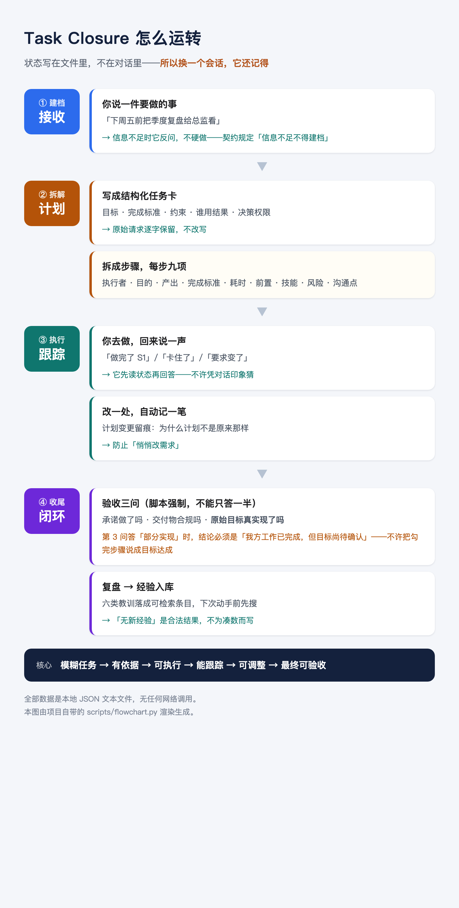
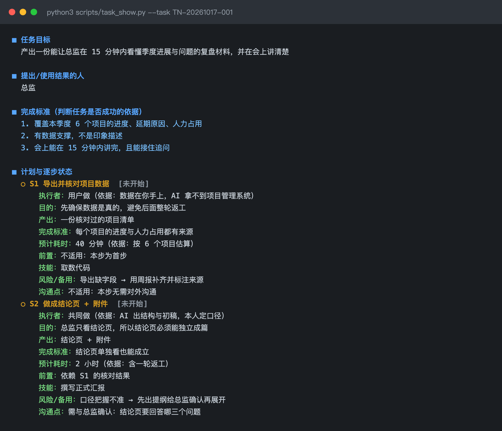

# Task Closure · 任务导航

> 把模糊任务变成**可验收的闭环**。
> 仓库名 `task-closure` 取的是它最核心的那一环：**把任务真正闭上，而不只是列出来**。

> 把工作、生活、学习、家庭或个人项目里的**模糊任务**，变成有依据、可执行、能跟踪、可调整、最终可验收的**任务闭环**。
>
> 这不是「一段帮你想点子的提示词」，而是**一套带状态的工作方式**：
> 你说要做一件事 → 它建档、拆步骤、记进度；你过两天回来说「卡住了」或「老板改要求了」→
> 它仍然知道当前状态、已完成什么、还缺什么、下一步最值得做什么。

**零第三方依赖**（纯 Python 标准库）· **数据全在你本地**（纯文本 JSON）· **MIT 许可**



---

## 它解决什么问题

普通的 AI 对话有两个毛病：

| 毛病 | 后果 |
|---|---|
| **没有状态** | 你上次说的进度，它不记得 |
| **只会给建议** | 给完一段漂亮的话就结束了，没人跟踪它有没有落地 |

任务导航的做法是：**把任务状态写进文件**，每次对话先读状态再开口。
于是「任务进行中回来更新」这件事才成立——这是它和普通提示词的根本区别。

---

## 三步开始

```bash
# 1. 初始化数据目录（建空的 state/，不会覆盖已有数据）
python3 nav.py init

# 2. 验证环境 + 跑全部测试（期望「全部通过」）
python3 nav.py test
```

**`nav.py` 是统一入口**——不用记 17 个脚本的名字：

```
python3 nav.py          # 看能做什么
python3 nav.py show     # 任务总览（每次开工先跑这个）
python3 nav.py test     # 跑全部测试
```

**Windows（PowerShell）**：把 `python3` 换成 `python`，其余相同。

```powershell
python nav.py init
python nav.py test
```

Windows 的默认行为有三处与本项目冲突，仓库里都已处理（v0.1.1）：

| 冲突 | 现在的处理 |
|---|---|
| 没有 `python3` 命令 | 文档给 `python` 写法；脚本不依赖命令名 |
| 输出被管道/文件接管时用 cp936，打印 ✅ 会崩 | `scripts/console.py`：非控制台流统一 UTF-8 |
| Git 默认把检出文件转成 CRLF，方法库哈希校验误报 | `.gitattributes` 固定 LF |

> **旧副本要重新检出一次**（`.gitattributes` 不会回溯修改已检出的文件）：
>
> ```powershell
> git rm --cached -r .
> git reset --hard
> ```
>
> 判断方法：`python scripts/validate.py --all` 若报 `M-INDEX-HASH` / `M-INDEX-DRIFT`
> 而数据没动过，就是换行符问题。也可以直接重新 clone。

```bash
# 3. 让 AI 按这份契约办事
#    把下面这句发给你的 AI：
#    「请读 skills/task-navigator/SKILL.md，之后所有任务相关对话都按它执行」
```

之后每次涉及任务，先跑 `python3 scripts/task_show.py`。

下面是它真实的输出样子（一张任务卡：目标、完成标准、以及每一步的执行者/产出/风险/沟通点）：



---

## ⚠️ 关于「自动生效」，请读这一段

**这套东西的有效性取决于一件事：AI 是否读了那份契约文件。**

有两种让它生效的方式，可靠性不同：

| 方式 | 怎么做 | 可靠性 |
|---|---|---|
| **手动**（默认） | 每次新会话，让 AI 读 `SKILL.md` | **取决于 AI 是否照做**。它可能读、可能不读、可能读了不照做 |
| 自动加载（需配置） | 见下方说明 | 配置对了就一定可见，但可见不等于会遵守 |

### 自动加载怎么配

DSH 有一个扫描 Skill 目录的组件 `@deepseek-ai/dsh-skill-filesystem`。
它**在 bundle 层默认是关闭的**，所以 `~/.agents/skills/` 里的 Skill 不会被发现。

在 profile 配置（`~/.dsh/profiles/<profile>/cordis.patch.yml`）末尾加上：

```yaml
  - id: skill-filesystem
    name: '@deepseek-ai/dsh-skill-filesystem'
    enabled: true
```

然后用软链接把 Skill 装到用户级目录（**真身唯一，改一处两边生效**）：

```bash
# macOS / Linux
ln -s "$(pwd)/skills/task-navigator" ~/.agents/skills/task-closure
```

```powershell
# Windows PowerShell：目录联接（Junction），本地 NTFS 上通常不需要管理员权限。
# 若提示权限不足：开启「开发人员模式」或用管理员 PowerShell；
# 也可以直接复制目录，但之后改仓库不会自动同步（不推荐）。
New-Item -ItemType Junction -Path "$HOME\.agents\skills\task-closure" `
  -Target "<仓库路径>\skills\task-navigator"
```

**告诉 AI 数据在哪**（装了多份仓库、或用 Junction 时强烈建议设置）：

```powershell
# Windows（当前会话；长期生效请用「系统环境变量」）
$env:TASK_CLOSURE_HOME = "<仓库路径>"
```

```bash
# macOS / Linux
export TASK_CLOSURE_HOME="<仓库路径>"
```

之后：

```bash
python nav.py env
```

会打印**实际使用**的项目根目录、数据目录与 Python。若 `TASK_CLOSURE_HOME`
与脚本所在仓库不一致，nav.py 会直接拒绝执行（退出码 5）——不允许静默写进第二套 `state/`。
未设置时以脚本所在仓库为准，单仓库用户可以不管它。

**Skill 的安装位置 ≠ 数据位置**：`~/.agents/skills/...` 只是 Skill 文件放的地方；
任务与经验永远在仓库的 `state/` 下。任何脚本都可以用 `python nav.py env` 自证数据目录。

### 证据边界：这四件事必须分开看

| 事项 | 状态 | 证据 |
|---|---|---|
| Windows 上的 Python 脚本 / 测试套件 | ✅ 已验证 | GitHub Actions 6 格（Ubuntu/Windows × 3.9/3.11/3.12）+ Windows 11 本机实测 |
| Windows 上的浏览器出图（Chrome/Edge → PNG/PDF） | ✅ 本机已验证 | Windows 11 实测；**CI 不覆盖**（runner 没装浏览器） |
| Windows 下 DSH profile 配置 + Skill 自动加载 | ⚠️ **未验证** | 只验证了配置文件语法；Windows 上的 Junction、重启后能否被发现未实测 |
| 新会话中 AI 是否实际读取并遵守 Skill | ⚠️ **无法由测试证明** | 这是行为问题，不是代码问题 |

> **不要把前三项中任何一项的通过，当成第四项的证据。**
> 配置生效 ≠ 能被发现 ≠ AI 会读 ≠ AI 会遵守。
> 如果你在 Windows 上配好了这一整套，欢迎提 issue 报告实际结果——目前它就是未验证状态。

### 必须分清的两件事

> **「AI 读到了规则」不等于「AI 遵守了规则」。**

作者本机有实测数据：在同一个项目里，

```
有代码强制（不满足直接拒绝）的规则      7 条  → 从未被违反
半强制（会被追问，但要靠 AI 如实回答）   2 条  → 偶尔被违反
纯自觉（没有任何检查点）               3 条  → 反复被违反
```

> 这三行不是手数的：跑 `python3 scripts/audit.py`，它逐条检查依据是否真的存在。
> 从 v0.1.2 起，审计把「源码里有这个词」与「行为测试证明运行时会拒绝」分开：
> 当前 7 条机械 + 2 条半机械由 `tests/unit/test_skill_guards.py` 的**行为探针**证实；
> 第 2 条（状态变更走脚本）只有源码线索、**未行为验证**；第 3、4、12 条纯自觉。
> **审计表本身也会和文档脱节**——v0.1.1 修过一次（表里漏了第 11、12 条），
> v0.1.2 起由 `tests/unit/test_audit_consistency.py` 守着条数与编号。

**所以「可靠执行」靠的是检查点，不是加载。** 详见 `skills/task-navigator/SKILL.md`。

---

## 里面有什么

| 目录 | 内容 |
|---|---|
| `skills/task-navigator/` | **核心**：`SKILL.md`（行为契约）+ 5 份 reference |
| `scripts/` | 21 个 .py：功能脚本 + 数据层 `store.py` + 工具 `console.py` / `make_test_workspace.py` |
| `spec/` | 需求与验收依据（脚本会读它来判断"做到了没有"） |
| `methods/` | 8 类公开方法论 + 选择规则 |
| `state/schema.json` | 数据契约。**必须保留**——删了脚本会报错 |
| `LICENSE` | MIT |

**依赖**：Python ≥ 3.9（3.9.6 / 3.12 实测通过）。**零第三方库。**
Windows 11 + Python 3.12 已实测（v0.1.3）：15 套测试全过，Chrome 出图可用。

---

## 隐私：经验与任务数据会被提交吗？

**默认不会。** 任务与经验都是**本地纯文本 JSON**，随仓库推送的是工具本身，不是你的使用记录：

| 内容 | 位置 | 会随 git 提交吗 |
|---|---|---|
| 任务状态 / 事件流 | `state/tasks.json`、`state/tasks.jsonl` | ❌ 已忽略 |
| 领域经验库（一条一个文件） | `state/experience/*.json` | ❌ 已忽略 |
| 流程教训 | `state/lessons/*.json` | ❌ 已忽略 |
| 经验派生索引 | `state/experience_index.md` | ❌ 已忽略（v0.1.2 补齐） |
| 交付物 / 导出 | `outputs/` | ❌ 已忽略 |
| 备份 / 流程图 / 覆盖率 / 自审 | `state/backups/`、`state/flowcharts/`、`state/coverage_checks/`、`state/self_reviews/` | ❌ 已忽略 |
| 测试证据与运行报告 | `reports/evidence/`、`reports/TEST_RUN_REPORT.md` | ❌ 已忽略 |
| 状态总览 | `STATUS.md` | ❌ 已忽略（v0.1.2 补齐） |
| 决策记录 | `decisions.md` | ❌ 已忽略（v0.1.2 补齐） |
| 技能档案 | `state/user_skills.json` | ⚠️ **在版本库里**（作为脱敏示例） |

**唯一需要你判断的是 `state/user_skills.json`**：它是「既是示例又被跟踪」的文件。
如果你把自己的真实技能档案写进去，`git add -A && git push` 会把它推上去。三种做法任选：

1. **保持它是脱敏示例**，真实档案放到私有 fork / 另一份不被跟踪的档案里；
2. **提交前核对**：`git diff --stat state/user_skills.json`，确认没有个人信息再提交；
3. **仓库设为私有**（私有仓库不出现在公开搜索中，但仍会进入你的 GitHub 账号数据）。

> 查当前工作区到底哪些文件会被提交：`git status --short`、`git ls-files state`。
> 验证敏感派生文件确实被忽略：
> `git check-ignore -v state/experience_index.md STATUS.md decisions.md`
>
> v0.1.2 之前，`state/experience_index.md` / `STATUS.md` / `decisions.md` **没有**被忽略，
> 用旧版本用过一阵子再升级的人请检查自己的 git 历史里是否已误提交（见 CHANGELOG）。

---

## 两台电脑共用经验库

经验是**一条一个文件**的本地 JSON（`state/experience/*.json`），天然适合用 git 同步。
但有一个硬约束必须先知道：

> **只同步 `state/experience/` + `state/lessons/` 不够。**
> 经验条目里有 `source_task_id`（必须指向 `tasks.json` 中存在的任务）与
> `related_skill_ids`（必须指向 `user_skills.json` 中的技能），`validate.py` 会做交叉核对。
> 只同步经验、不同步任务与技能档案，另一台机器会报 `E-SOURCE` / `T-XREF-*`。
> 所以真正能分享的是一个**自洽的 `state/`**：任务 + 经验 + 教训 + 技能档案一起。

### 方案 A（推荐）：私有工作仓库（代码 + 数据）

- 以公开版本为基线建一个 **private** 仓库（例如 `task-closure-private`），
  把现有 `state/` 数据（`tasks.json`、`tasks.jsonl`、`experience/`、`lessons/`、
  `user_skills.json`、`experience_index.md` 等）导入并提交；
- 两台电脑都 clone 这个私有仓库，用它当工作目录：开工前 `git pull`，收工后
  `git add -A && git commit && git push`；
- 更新代码：把公开仓库加为 upstream，`git fetch upstream && git merge upstream/main`；
- 私有副本要额外做两件事（否则数据同步不上、测试会误报）：
  1. 在 `.gitignore` 末尾**追加否定规则**，把要同步的数据路径放回来
     （`!state/tasks.json`、`!state/experience/` 等；保留 `state/backups/`、`outputs/`、
     `reports/`、`STATUS.md` 的忽略）；
  2. 放一个 `PRIVATE-WORKSPACE.md` 标记文件——`tests/unit/test_privacy_gitignore.py`
     看到它就切换为「数据应可跟踪、生成物仍忽略」的检查；
- 私有副本里 `state/` 数据在 Windows 上可能以 CRLF 落地（脚本生成）；`test_line_endings`
  会自动跳过这些数据文件（它们不参与按字节的哈希校验，提交时仍会规范化为 LF）。
  代码、文档、`methods/` 仍强制 LF；
- 优点：数据与代码在同一个仓库里，校验、检索、经验引用永远一致，**没有链接可踩坏**；
- 代价：代码更新和个人数据混在一条历史里，上游改 `.gitignore` / `CHANGELOG` 时可能要解冲突。
  经验是独立文件，合并友好；`tasks.json` 是单文件，尽量避开两台机器同时改。

### 方案 B：私有数据仓库 + 把整个 `state/` 链接过去

- 新建 **private** 仓库（例如 `task-closure-data`），里面放**整个 `state/` 目录**
  （含 `schema.json`），不放代码；
- 两台电脑各 clone 公开代码仓库 + 数据仓库，然后把代码仓库的 `state` 指过去：

```powershell
# Windows：先把原 state 目录移走，再建 Junction（本地 NTFS 通常不需要管理员权限）
Move-Item "<代码仓库>\state" "<代码仓库>\state.bak"
New-Item -ItemType Junction -Path "<代码仓库>\state" -Target "<数据仓库>\state"
```

```bash
# macOS / Linux
mv "<代码仓库>/state" "<代码仓库>/state.bak" && ln -s "<数据仓库>/state" "<代码仓库>/state"
```

- 代码更新与数据更新互不干扰；但 `state/schema.json` 随代码升级，代码升级后要同步一次；
- 风险：链接失效（数据仓库被移动/删除）时，脚本可能在代码仓库里重建一个 `state/`，
  变成两套数据。用 `python nav.py env` 确认数据目录，并定期检查链接。

### 不建议：只同步经验/教训

会破坏交叉引用（见上面的硬约束），另一台机器 `validate.py` 直接报错。

### 不管选哪个

- 仓库必须是 **Private**（`git remote -v` 确认推的是私有地址）；公开仓库只放代码；
- **不要**用 OneDrive / iCloud 同步 `.git` 目录，也不要把数据仓库嵌套在代码仓库里；
- 同一时间尽量只在一台电脑写经验，写完 push 再换机；
- 冲突处理：经验是独立 JSON，保留两边文件即可（重名时改文件名并同步改 `experience_id`）；
- 验证：`python nav.py env` 看数据/经验目录，`python nav.py validate` 确认交叉引用完整。

---

## 测试

**测试是随包提供的**，一条命令跑完：

```bash
python3 nav.py test           # 全部（Windows 实测约 30 秒）
python3 nav.py test --quick   # 跳过场景测试（Windows 实测约 16 秒）
```

| 套件 | 守什么 | 规模 |
|---|---|---|
| 数据完整性校验 | `state/` 是否符合 `schema.json` | 500+ 项检查 |
| **反例测试** | **每条校验规则都配一个「必失败」样本** | 53 个 |
| 场景测试 | 端到端行为断言 | 157 条 |
| 单元测试 | 依赖判断、项目根定位、渲染成功判定、经验冲突判定、技能摘要触发词、控制台编码、换行符、隐私忽略、审计一致性、SKILL 行为探针、md2html、跨平台路径 | 12 套 |

**反例测试是这套东西的关键**：它保证校验规则不是摆设。
本项目为此付过代价——有过「规则只注册了名字、检查代码没实现」的情况，
因为当时没人跑反例，问题一直没暴露。

**CI**：每次 push / PR 在 Ubuntu 与 Windows 上、Python 3.9 / 3.11 / 3.12 自动跑全部测试。
Windows 那一格是 v0.1.1 补的——此前只有 Ubuntu，所以「Windows 没跑过」一直没人挡。
（CI 通过只能说明这些测试在上述环境通过，**不能**说明 AI 会遵守 Skill，也不能代替
Windows + DSH 自动加载的实机验证——见上面「证据边界」。）

## 一条命令看它能干什么

```bash
python3 nav.py show          # 任务总览（同时打印"开工必读"）
python3 nav.py --help        # 全部命令
```

数据都在 `state/` 里，是**人可读的 JSON**——你可以直接用文本编辑器看和改。

---

## 设计上刻意**不做**的事

| 不做 | 为什么 |
|---|---|
| 不自动发消息 / 不提交表单 / 不代你对外沟通 | 外部动作必须有你的明确授权。可以准备草稿，不能替你发 |
| 不控制浏览器 | 同上，且违反大多数平台条款 |
| 不上传你的数据到任何服务器 | 全部本地文件 |
| 不因为「你在我指导下做过一次」就判定你已掌握某项技能 | 技能状态需要独立操作证据才能升级 |

---

## 已知限制（不粉饰）

1. **它不会自己变聪明。** 规则要生效，得靠 AI 每次真的去读、真的照做。上面那条「必须分清的两件事」就是在说这个。
2. **`spec/` 是必要依赖。** 脚本会读它。**不要删**，也不要只复制 `scripts/`。
3. **测试随仓库提供**（`tests/`：157 条场景断言 + 53 条反例 + 12 套单测），
   `python nav.py test` 一条命令跑完；CI 也会跑。
4. **实测环境**：macOS + DSH（开发环境）；Windows 11 + Python 3.12（v0.1.3 补测，
   15 套测试全过）。**Linux 未完整实测**——CI 的 Ubuntu 任务就是它的第一道验证。

---

## 更新记录

见 `CHANGELOG.md`。当前版本 `0.1.5`——**`0.x` 的意思是接口与数据契约仍可能变**，
不是谦虚，是它还没在足够多的真实任务上验证过（见「已知限制」）。

## 许可

MIT，见 `LICENSE`。
